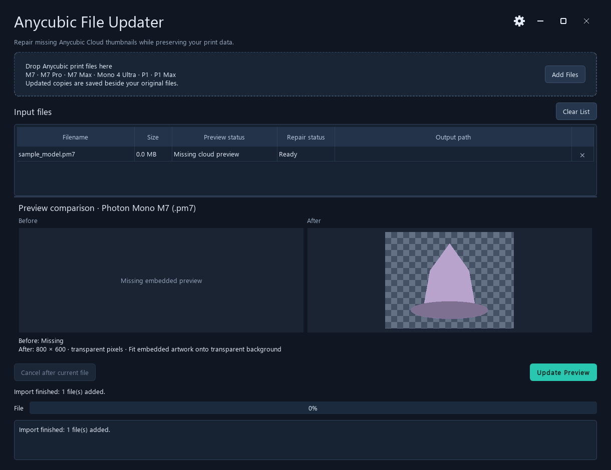
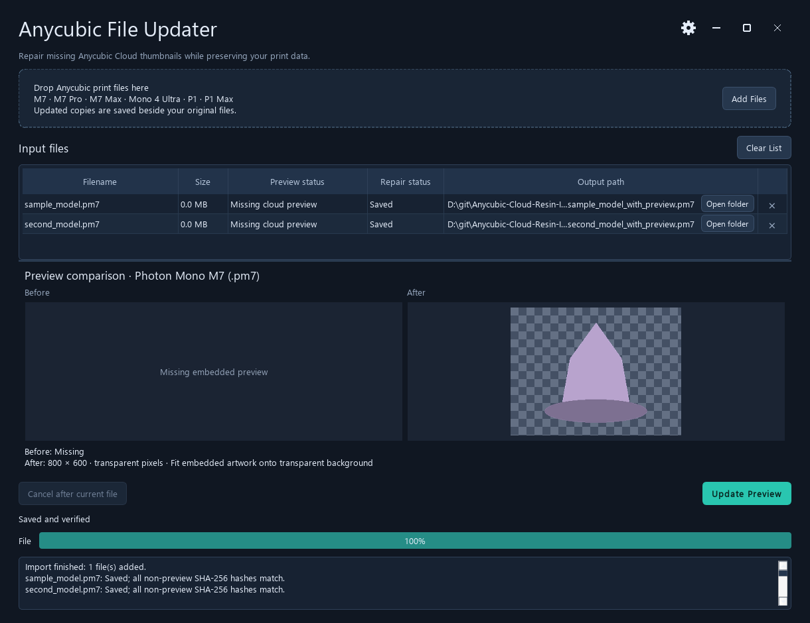
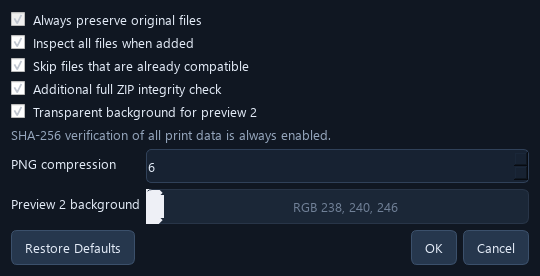

# Anycubic File Updater

A Windows desktop app for repairing embedded PNG previews in ZIP-based Anycubic resin files.
Everything runs offline. The original input file is always preserved. Only
`preview_images/preview_2.png` may change. Previews 0 and 1 are preserved byte-for-byte;
missing printer previews are never created.

## Screenshots

The screenshots below show the current app using generated sample artwork.

### Preview comparison

Compare the embedded preview 2 with the proposed update before saving. Transparent areas
are shown on a checkerboard.



### Saved outputs

Process every file in the list and save updated copies beside their originals. Use
**Open folder** beside an output path to find the saved file in Explorer.



### Settings

Choose preview 2 transparency, PNG compression, inspection behavior, and integrity checks
from the Settings gear.



## Printer and file-format support

Version 1.1 adds all three documented M7 models and other printers using the same archive family:

| Printer | Extension |
| --- | --- |
| Photon Mono M7 | `.pm7` |
| Photon Mono M7 Pro | `.pwsz` |
| Photon Mono M7 Max | `.pm7m` |
| Photon Mono 4 Ultra | `.pm4u` |
| Photon P1 | `.pp1` |
| Photon P1 Max | `.pp1m` |

The printer mappings are listed in [CHITUBOX's supported-printer documentation](https://tm.chitubox.com/en-US/chitubox/latest/introduction).
The shared ZIP family, embedded PNG paths and cloud preview size are described by the
[UVtools AnycubicZipFile implementation](https://github.com/sn4k3/UVtools/blob/master/UVtools.Core/FileFormats/AnycubicZipFile.cs).
These are format references; the app does not bundle UVtools or its implementation.

Repair is conditional on the actual file structure: a valid ZIP archive with
`anycubic_photon_resins.pwsp`, embedded `layer_images/` files and usable PNG preview artwork.
Printer-specific settings and layers are copied as opaque data and verified with SHA-256.
Both `.pw0Img` and `.pwszImg` layers are retained without decoding, renaming or conversion.

The original extension is always retained: `model.pwsz` becomes `model_with_preview.pwsz`,
and `model.pm7m` becomes `model_with_preview.pm7m`. Changing the extension to another printer's
format is rejected. File import is case-insensitive.

Older binary formats such as `.photon`, `.pwmb`, `.pm5s` and `.m5sp` are **not supported** by
this ZIP/PNG repair. Renaming one of those files will not make it compatible. Actual slicer
exports and Anycubic Cloud rendering still need manual validation for each printer; synthetic
format tests are not evidence of live printer or cloud compatibility.

## Install and use

Download **[AnycubicFileUpdater-Setup.exe from the latest release](https://github.com/meltiseugen/Anycubic-Cloud-Resin-Image-Preview-Updater/releases/latest/download/AnycubicFileUpdater-Setup.exe)**,
then run the downloaded file. The installer installs for your Windows user,
adds Start menu and optional desktop shortcuts, and includes an uninstaller. No Python,
administrator rights, cloud account, or internet connection is needed. The build targets
Windows 10/11 x64 (Windows ARM64 requires x64 emulation). The executable is unsigned.

Alternatively, download the **[portable EXE](https://github.com/meltiseugen/Anycubic-Cloud-Resin-Image-Preview-Updater/releases/latest/download/AnycubicFileUpdater.exe)**
and run it directly without installing. Release assets also include `SHA256SUMS.txt`.

If no release has been published yet, or you want the latest development build:

1. Open **[Actions → Build Windows installer](https://github.com/meltiseugen/Anycubic-Cloud-Resin-Image-Preview-Updater/actions/workflows/build-windows.yml)**.
2. Select a successful run and download **AnycubicFileUpdater-Windows-x64** under **Artifacts**.
3. Extract the downloaded ZIP and run `AnycubicFileUpdater-Setup.exe` (installer) or
   `AnycubicFileUpdater.exe` (portable).

GitHub requires signing in to download Actions artifacts. Artifacts are retained for 30 days;
published release downloads remain available. The repository contains source code; `dist/` is
generated during builds and is intentionally excluded from Git. GitHub's **Code → Download ZIP**
contains source, not the Windows executables.

1. Click **Add Files** and select individual Anycubic print files, or drag selected files onto
   the app. Folder input is not supported. Select a row to see before/after previews and the
   printer format.
2. Inspect the before/after comparison for preview 2. Missing cloud artwork is generated
   from existing embedded artwork. Transparent areas appear on a checkerboard.
3. Click **Update Preview**. The updated copy is saved automatically beside its original as
   **`original_with_preview`** followed by the original extension. No output-folder or save-file
   selection is needed. Your original file is preserved.
4. Wait for **Saved** and the integrity verification message. **Open folder** beside the output
   path opens Explorer with that output file selected. Hover over a shortened path to see its full location.
   Upload the output to Anycubic Cloud.

The window uses borderless controls matching the dark interface. Drag the heading to move it,
double-click it to maximize or restore, and drag any window edge or corner to resize.
The Settings gear, minimize, maximize/restore and close controls sit beside the heading.
**Update Preview** is aligned at the right below the comparison. A single progress bar shows
the current file; there is no separate batch progress bar.

**Update Preview** processes every file in the list. There is no row selection or separate
batch action. Clicking a row only changes the comparison being displayed.
Each result is saved in its own source folder with the `_with_preview` suffix. Identical filenames
in different folders produce separate outputs. Existing outputs require overwrite confirmation;
imported input files cannot be overwritten. Invalid files fail independently; other jobs continue.
Use the **×** at the end of a row to remove it, or **Clear List** above the table at the right to
empty the list. Neither action deletes files from disk. **Cancel after current file** finishes
the current file safely, then stops. Close the app after the worker finishes.

Already compatible files are skipped by default, producing no output. To save them anyway,
turn off **Skip files that are already compatible** in Settings. Existing previews that match
the selected output settings are kept byte-for-byte.
If **Inspect all files when added** is disabled, selecting a file inspects it on demand.

Enable **Transparent background for preview 2** in Settings to preserve embedded transparency
on its `800 × 600` canvas. An existing transparent preview 2 takes priority; otherwise the
highest-resolution transparent embedded artwork is used. Previews 0 and 1 are only read as
possible artwork sources and are never rewritten. The comparison shows only preview 2, with
no selector. Transparency is on by default for new settings and Restore Defaults; an explicitly
saved preference is retained. The preview 2 background-color picker is disabled when enabled.
Solid backgrounds baked into every embedded preview are preserved; this setting does not
remove them or reconstruct missing transparency.

## Repair and integrity

- Previews 0 and 1: existing PNG bytes and ZIP metadata are copied and SHA-256 verified.
  Missing entries remain missing; compatibility depends only on preview 2.
- Preview 2: `800 ? 600`, with transparency enabled by default. Existing transparent cloud
  artwork takes priority; otherwise transparent embedded artwork is used when available.
  With transparency disabled, the background is RGB `(238, 240, 246)` by default.
  LANCZOS scaling preserves aspect ratio with centered padding.
- Files without embedded PNG artwork, including entirely transparent sources, are unsupported.
  Duplicate ZIP entries, encrypted archives, invalid PNGs, non-ZIP files and unrecognized archive
  layouts are rejected.
- Every other ZIP entry is streamed in 1 MiB chunks. SHA-256 checks verify every copied entry,
  including all layers, configuration and unknown files. Entry timestamps, comments, compression
  methods, external attributes and archive comments are retained where Python ZIP support permits.
  Compressed archive bytes may change; uncompressed print-data bytes must match exactly.
- A temporary file in the destination folder is fully verified before atomic publication.
  Failures leave existing destinations intact. A crash can leave a hidden `.pm7-preview-*.tmp`
  file, which may be deleted after the app has stopped. No extraction of print files is performed.
- SHA-256 and output preview validation are always enabled. Settings can disable the additional
  full ZIP CRC pass. Image limits are 48 MiB encoded and 32 million pixels per preview.

Settings are stored locally using Windows QSettings (`HKCU\Software\PM7PreviewFixer`).
Settings include preview 2 transparency, skip compatible files, auto-inspection, PNG compression,
background colors, and extra ZIP checking. **Restore Defaults** resets all choices. Original-file
preservation is always enabled. Logs rotate in the per-user AppLocalData directory (usually
`%LOCALAPPDATA%\PM7PreviewFixer\PM7 Cloud Preview Fixer\app.log`).

## Develop and test

Use Python 3.12+ on Windows:

```powershell
py -3 -m venv .venv
.\.venv\Scripts\python.exe -m pip install -e ".[dev]"
.\.venv\Scripts\python.exe -m anycubic_file_updater.app
.\.venv\Scripts\python.exe -m pytest -q
.\.venv\Scripts\python.exe -m ruff check src tests tools
```

Tests build synthetic archives for all six formats, including a 2,486-layer PM7 fixture. They check
extension preservation, printer-specific dialogs, both layer-entry extensions, opaque backgrounds,
artwork colors, dimensions, highest-resolution source selection, idempotence, SHA-256 integrity,
metadata preservation, corrupted layers, failed writes, cancellation, batch isolation, bounded
preview caching, and actual Qt file import / automatic-output / drag-and-drop flows. A fresh-process
smoke test also checks startup and clean shutdown. GUI tests use Qt's offscreen backend.

No user reference PM7 files were supplied with the initial specification. To enable the optional
reference checks, set `PM7_REFERENCE_DIR` to a folder containing:

- `rapunzel_continuarea_Plate 5.pm7`
- `01_preset_model.pm7`
- `rapunzel_cloud_preview_opaque.pm7`

These large/private files are excluded from Git. **Anycubic Cloud rendering and live printing
require manual acceptance with actual files. Offline tests cannot establish those results.**

## Automated builds and releases

[`.github/workflows/build-windows.yml`](.github/workflows/build-windows.yml) builds on Windows x64
with Python 3.13 and Inno Setup. It runs on pushes to `main`, pull requests targeting `main`,
version-tag pushes (`v*`), and **Run workflow** on the Actions page.

Each run installs the locked build dependencies, runs the tests, builds the standalone app and
installer, checks code quality, then runs the bundled EXE in an isolated working directory with
Python removed from PATH. The smoke test checks repair, all six file formats, SHA-256 integrity,
ZIP integrity, Qt startup and clean shutdown. Successful runs upload both EXEs and SHA-256 checksums
as the **AnycubicFileUpdater-Windows-x64** artifact. Failed runs upload available build diagnostics.

To publish a release after committing and pushing the source/workflow:

```powershell
git tag v1.1.1
git push origin v1.1.1
```

The tag must match the version in `pyproject.toml`. For future releases, also update
`src/anycubic_file_updater/__init__.py`, `packaging/version.txt`, and `packaging/installer.iss` to the same version
before tagging. After a successful tagged build, a separate job creates a GitHub Release and
attaches both EXEs and `SHA256SUMS.txt`. Re-running that tag's workflow replaces its release assets.
Normal branch, pull-request and manual builds only upload Actions artifacts. No personal access
token or extra repository secret is required; the release job uses the built-in `GITHUB_TOKEN`.

## Build the EXE and installer locally

Install Python 3.12+ x64 and [Inno Setup 6.4+ or 7](https://jrsoftware.org/isdl.php), then run:

```bat
build_windows.bat
```

The script installs build dependencies into `.venv`, collects license texts, runs tests, bundles
the standalone executable with PyInstaller, and compiles the installer. Set the `ISCC` environment
variable to the full `ISCC.exe` path if Inno Setup is not found automatically. Outputs:

```text
dist/AnycubicFileUpdater.exe
dist/AnycubicFileUpdater-Setup.exe
```

These are local output paths, not files committed to the repository. To run the same packaged-app
verification and generate checksums locally:

```powershell
powershell -NoProfile -ExecutionPolicy Bypass -File .\tools\verify_windows_build.ps1
```

For an existing environment without pip, use `uv pip install --python .venv/Scripts/python.exe
-e ".[dev]"`, then run license collection, pytest, PyInstaller and ISCC directly as in the script.
For repeatable builds, `requirements-build.lock` records the exact dependencies used for this build.

To exercise bundled Pillow, ZIP repair, SHA-256 verification and Qt startup without user files:

```powershell
$env:QT_QPA_PLATFORM = 'offscreen'
Start-Process -FilePath .\dist\AnycubicFileUpdater.exe -ArgumentList '--smoke-test', 'smoke.json' -Wait
Get-Content smoke.json
```

The repo separates the printer/extension registry (`formats.py`) and pure archive/image logic
(`core.py`) from Qt workers/widgets (`ui.py`), local settings (`settings.py`), application startup
(`app.py`) and packaging definitions (`packaging/`). The visible app and download names are now
Anycubic File Updater. The installer AppId, existing installation directory, internal
settings/log identity
are retained so existing installations can upgrade without losing preferences. The installer
replaces the old executable and shortcuts with the renamed ones.
